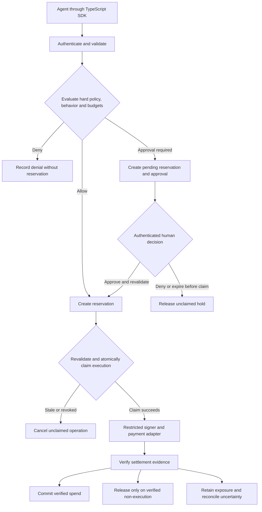

# Scuta

> Adaptive spending authorization for autonomous agents.

Scuta is being built to control agent transactions using observed behavior and financial exposure: enforce owner-defined limits, account for pending and uncertain payments, and adjust how much an agent may spend without human approval.

**Status: Phase 0 implemented; Phase 1 trusted configuration and atomic budget admission implemented locally.** The private TypeScript core validates purchases, checks static policy and reserves every applicable wallet/agent/delegation budget together. Scoped retries retain the original decision, hold and expiry; ceiling reductions preserve outstanding exposure. SQLite uses store-only Drizzle queries with checked records and native transactions; memory is a nondurable test adapter. Execution claims, reconciliation/recovery workers, human approvals, adaptation, gateway isolation and payment execution remain pending. Neither a static `ALLOW` nor a reservation is permission to sign. See the [Task 5 record](docs/development/phase-1.md#task-5--trusted-configuration-and-atomic-admission).

## Try Phase 0

Use Bun **1.3.14** from the repository root:

```sh
bun install --frozen-lockfile
bun run check
bun run demo
```

The demo is still static-policy-only; admission is exercised by the memory/SQLite tests, including two 70-unit purchases against a 100-unit budget yielding one hold and one denial. The local demo evaluates three mock purchases: ordinary spending is allowed, spending above the autonomous allowance requires approval, and spending above the owner hard ceiling is denied. It uses fixed time and makes no network calls or payments.

The [runnable example](apps/example/src/static-policy-demo.ts) imports the built `@scuta/core` workspace package. [Public exports](packages/core/src/index.ts) include `evaluatePolicy`, `createLedger`, validators and digest helpers. `createLedger` is a trusted internal API—not an agent-accessible configuration or payment tool. Amounts enter as canonical decimal strings and become bounded `bigint` values; the evaluator takes typed wire objects plus explicitly supplied host scope and time, revalidating every input at runtime. GET forbids a body digest; POST requires one in both the types and validation. Malformed input throws a redacted, field-specific `ValidationError`; valid disallowed input returns `DENY`.

Run `bun run test` for a build and guarded test run, or `bun run test:watch` during development. `bun test` also works after building. Tests and fixtures live in each component's `test/` folder, separate from `src/`; tooling tests live in `scripts/test/`. See the [Phase 0 record](docs/development/phase-0.md) and [Phase 1 record](docs/development/phase-1.md) for verified commands, test evidence and limitations. Nothing is published to a registry.

[GitHub Actions](.github/workflows/check.yml) runs the same checks on pushes and PRs. See the [CI expectations](CONTRIBUTING.md#continuous-integration).

## Objective

Give agents useful financial autonomy while containing unwanted spending from runaway or compromised agents. The adaptive engine may tighten authority; it cannot override owner limits.

The research question is whether adaptive restrictions and controlled recovery reduce harmful spending compared with strong static policies, without unacceptable loss of legitimate task completion or excessive approvals. That benefit must be measured, not assumed.

## What the Complete Project Will Do

- Enforces hard transaction ceilings, shared budgets, permitted destinations, and capabilities.
- Reserves budget before execution, including payments waiting for approval or reconciliation.
- Uses deterministic behavioral rules to reduce autonomous allowances, require approval, or freeze new execution.
- Binds human approval to one exact purchase; approval does not restore general authority.
- Records decision reasons, policy versions, authority changes, and payment outcomes.

The intended users are developers whose agents buy paid API access or services, and operators responsible for their budgets. The wallet handles funds and signing; Scuta controls access to that payment authority. The policy core is separate from the payment adapter, but each supported adapter must prove its execution and reconciliation guarantees.

## Payment Flow (Planned)



The three controls are separate: **hard limits**, **current autonomous allowance**, and **approval eligibility**. For example, an owner might set a $20 transaction ceiling, a $100 rolling budget, and a $10 autonomous allowance. Suspicious activity could lower the autonomous allowance to $2. An eligible $8 purchase would then need approval; a $21 purchase would still be denied. These are illustrative settings, not safe production defaults.

## Initial Architecture and Scope

One TypeScript gateway, internal core modules, one authoritative SQLite store, and a restricted payment adapter. Bun is the development runtime, package manager, and test runner. Phase 0 has no database or payment execution.

The first example uses a mock x402 `exact`/EIP-3009 profile with one configured asset and network. A complete initial release also needs one verified external sandbox/testnet integration; no hosted wallet provider is selected. Adaptation is opt-in, hard controls always apply, and the initial behavior engine needs no LLM.

Gateway enforcement requires exclusive payment credentials outside the agent process. An embedded library is only a guardrail if host code can bypass it. Trusted gateway, administrator, and provider compromise are outside the threat model. A freeze cannot necessarily recall an already issued payment authorization.

Custody infrastructure, trading, arbitrary contract calls, token allowances, cross-asset valuation, multiple providers, dashboards, and multi-host deployment are outside the initial scope. Scuta does not promise perfect compromise detection or zero loss.

## Development Phases

0. Contracts and static policy: exact inputs, delegation checks, pure evaluation, Bun tooling and boundary tests.
1. Ledger and execution safety: atomic holds, scoped retries, execution identities, durable events and crash recovery.
2. Mock x402 payment: isolated gateway, restricted signer and verified accounting end to end.
3. Durable approvals: authenticated consent, expiry, queue bounds and separate recovery permissions.
4. Adaptive authority: deterministic signals, reviewed baselines, persistent restrictions and controlled recovery.
5. Evaluation and adoption: static comparisons, fault injection, one external integration and reproducible results.

Tests expand in every phase. See the [canonical roadmap and acceptance gates](docs/core-authorization-design.md#17-implementation-phases). A static limit wrapper alone does not complete Scuta.

## Documentation and Contributions

| Document                                                       | Purpose                                                                     |
| -------------------------------------------------------------- | --------------------------------------------------------------------------- |
| [How Scuta works](docs/how-scuta-works.md)                     | Fixed goals, beneficiaries, flows, adaptation, scope and success criteria   |
| [Core authorization design](docs/core-authorization-design.md) | Algorithms, contracts, guards, accounting invariants, scenarios and roadmap |
| [Technology decisions](docs/technology-decisions.md)           | Why each stack choice exists, its cost and when to reconsider               |
| [Phase 0 record](docs/development/phase-0.md)                  | Initial intent, expected outcome, test plan, scripts and actual evidence    |
| [Contributing](CONTRIBUTING.md)                                | Starter tasks, code standards, verification and PR expectations             |

Boundary tests, scenario proposals, documented counterexamples and focused implementation PRs are welcome. Start with the contributor setup and current phase gates. Every feature must strengthen authorization, exposure accounting, adaptation, approval safety, or evidence of those properties; otherwise defer it.

Use no real funds or secrets in the initial example. A private security-reporting contact must be configured before executable public release. Licensed under [MIT](LICENSE); licensing does not imply production readiness.
