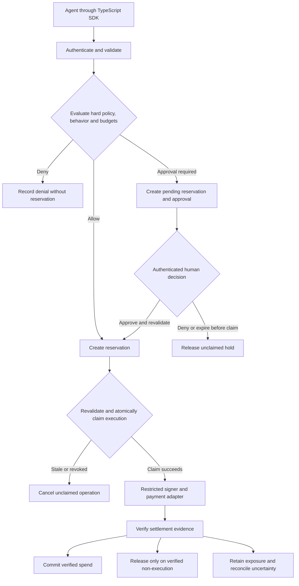

# Adaptive Agent Authorization

> A TypeScript authorization layer that adjusts an autonomous agent's financial authority as its behavior changes.

**Status: design stage.** This repository currently contains documentation. There is no executable SDK, gateway, package installation, or verified security implementation yet. It is intended for open-source release after a license is selected.

[Core design](docs/core-authorization-design.md) · [Contributing](CONTRIBUTING.md) · [Development phases](#development-phases)

## What We Are Building

Adaptive Agent Authorization will sit between an agent and its payment infrastructure. The agent proposes a purchase; the service checks policy and behavior, reserves the maximum permitted exposure, coordinates approval when needed, and controls execution through a restricted signer.

The system returns `ALLOW`, `DENY`, or `REQUIRE_APPROVAL`. Observable changes in the agent's behavior can lower its autonomous allowance, require approval for more payments, or freeze new execution. Human approval of one payment does not restore the agent's general authority.

The wallet provides custody and signing. This project provides the authorization, accounting, and recovery logic around its use.

## Why It Exists

Static policies can already enforce recipient restrictions, amount limits, and rolling velocity thresholds. This project adds a configurable behavior model and persistent authority state: what an agent can do autonomously changes with its observed history and current activity.

A useful demonstration is an agent buying API access normally, entering a retry loop, having its allowance reduced, and needing approval for a subsequent unusual purchase. Duplicate execution, concurrent requests, and process restarts must not bypass the controls.

The question motivating the project is:

> Can behavior-driven restrictions and controlled recovery reduce financial loss while preserving useful autonomy, compared with strong static policies?

## Three Separate Controls

| Control | Purpose |
|---|---|
| Hard ceiling | Owner-defined limits on transaction value, total exposure, destinations, and capabilities. Ordinary approval cannot override them. |
| Autonomous allowance | The amount and activity currently permitted without human approval. Behavior can reduce it within the hard ceiling. |
| Approval eligibility | Rules for payments that are permissible only with a separate human decision. Approval is for one exact operation. |

An illustrative profile could set a $20 hard transaction ceiling, a $100 rolling 24-hour budget, and a $10 normal autonomous transaction allowance. The autonomous allowance falls to $2 in `RESTRICTED`; in `APPROVAL_REQUIRED`, every otherwise eligible payment needs approval. In `FROZEN`, no new execution claim is permitted.

An $8 payment can therefore run automatically in `NORMAL` but require approval in `RESTRICTED`. These figures are demonstration settings, not validated safe defaults. The [reference policy](docs/core-authorization-design.md#6-reference-adaptive-policy) supplies complete example rules.

## How It Works

The first reference deployment is one authorization service with internal modules and one authoritative SQLite database.



Decision, reservation, authority changes, and durable events are committed together. Signing and network calls happen afterward. Every operation has a stable execution identity and payment nonce.

## Core Modules

| Module | Responsibility |
|---|---|
| Request boundary | Derive identity and delegation from credentials; canonicalize the payment intent. |
| Hard-policy engine | Check all applicable ceilings, recipient restrictions, and supported capabilities. |
| Behavior engine | Compute deterministic velocity, amount-deviation, and recipient-familiarity signals. |
| Authority engine | Set effective autonomous allowances and persistent restriction states. |
| Reservation ledger | Account atomically for committed spend and outstanding exposure across every applicable budget. |
| Approval broker | Deliver durable, expiring approval requests and validate exact-operation responses. |
| Execution coordinator | Recheck current authority and claim one stable payment operation before signing. |
| Settlement reconciler | Verify evidence and commit spend or release exposure only when justified. |
| Audit recorder | Persist decisions and transitions, with optional integrity checkpoints later. |

These are logical modules, not nine microservices.

## Authority and Recovery

| State | Behavior |
|---|---|
| `NORMAL` | Owner-configured autonomous allowances apply. Cold-start restrictions still apply when history is insufficient. |
| `RESTRICTED` | Smaller autonomous allowances; larger eligible payments require approval. |
| `APPROVAL_REQUIRED` | Every eligible payment requires approval. |
| `FROZEN` | New execution claims are blocked. Recovery requires a separate operator action. |

Restriction can happen immediately. Automatic recovery, when enabled, requires a cooldown, sufficient trusted observations, and no unresolved incident. Otherwise the operator must recover the agent explicitly.

Approving a purchase does not change this state. Approval rejection or timeout alone does not freeze an agent. A freeze cannot recall a payment signature already released to another party; that operation remains counted until its outcome is resolved.

## Intended Security Properties

These are implementation and test requirements, not established guarantees:

- Agents cannot administer their own policies, approvals, budgets, or baselines.
- New reservations fit every applicable hard budget atomically.
- Historical decisions are not reusable permission to execute.
- One reservation binds one execution identity and one payment authorization.
- Execution rechecks policy version, delegation, expiry, and current authority.
- Pending and uncertain operations remain exposure across time-window boundaries.
- Only authenticated, validated settlement evidence can release an executed operation's hold.
- Approval, recovery, and policy administration use separate permissions.
- Durable events survive crashes without authorizing duplicate execution.

Lowering a limit cannot erase prior spend or outstanding obligations. If exposure exceeds a newly lowered limit, available headroom becomes zero.

## Behavior Analysis and Merkle Trees

The first behavior engine uses deterministic rules and exact integer comparisons. It requires no LLM. An optional language model may explain an existing decision, but its output cannot relax a guard, approve a purchase, or change authority.

Operational attempts and baseline training are separate streams. Denied requests can affect abuse counters without becoming examples of normal spending. Settled payments are not automatically safe baseline observations.

Indexed database records and rolling aggregates support behavioral evaluation. Merkle trees support verifiable audit history; they do not accelerate general anomaly detection. Durable event recording comes first. Hash chains and optional Merkle proofs require independently retained checkpoints to detect rollback or history replacement.

## Deployment and Initial Scope

The reference gateway runs outside the agent process and is the exclusive path to the signer. Isolation is introduced with the first executable payment example, not deferred until the end.

The core may also be embedded in an application. Embedded guardrail mode assumes the host invokes it correctly; it does not withstand arbitrary code that can bypass it and reach the signer.

Initial scope:

- TypeScript; strict validation; integer atomic amounts and decimal-string wire encoding.
- Memory store for tests and SQLite for persistence.
- One configured asset and network; x402 `exact` with EIP-3009 as the first adapter profile.
- Mock payment infrastructure before any testnet work.
- No arbitrary contract calls, token approvals, cross-asset conversion, or agent-accessible raw-signing endpoint.
- Adaptive controls opt-in; hard controls always active.
- Portable authorization proofs, additional providers, and Merkle proofs deferred.

Cloudflare or other wallet and agent infrastructure can be added behind adapters if access and the enforcement contract permit it. No provider is required for the mock example.

## Planned Repository Structure

```text
apps/
  gateway/       API, approval delivery, expiry and reconciliation workers
  example/       Example agent and mock paid resource
packages/
  core/          Policy, behavior, authority and lifecycle contracts
  store/         Memory and SQLite adapters
  x402/          Challenge validation, signer boundary and payment adapter
  testkit/       Scenario runner, deterministic clock and fault injection
docs/
  core-authorization-design.md
README.md
CONTRIBUTING.md
```

Only the Markdown documents currently exist.

## Development Phases

| Phase | Deliverable and acceptance gate |
|---|---|
| 0 — Contracts and static policy | Workspace, identity binding, canonical requests, policy rules, selected license, CI and static boundary tests. |
| 1 — Ledger and execution safety | Atomic reservations, scoped idempotency, stable execution identities, outbox, crash recovery and concurrency tests. |
| 2 — Mock x402 payment | Isolated gateway and mock signer; normal, duplicate and uncertain payments accounted for end to end. |
| 3 — Durable approvals | Authenticated approvals, current-state revalidation, bounded pending requests and separate operator recovery. |
| 4 — Adaptive authority | Three deterministic signals, versioned baseline, explicit restrictions and recovery, worked scenario traces. |
| 5 — Evaluation and adoption | Strong static comparisons, fault-injection suite, measured overhead, usable examples and release documentation. |

Scenario tests start with the first contracts and expand in every phase. Optional audit proofs and extra integrations follow demonstrated need.

## Evaluation and Existing Work

Compare basic static limits, velocity-enhanced static controls, contextual static policies with approval, and adaptive authority under the same hard ceilings. Match or report approval burden and legitimate task completion so that blocking everything cannot count as success.

Measure loss before containment, false blocks, task completion, approval demand, recovery time, unresolved exposure, authorization latency, and storage overhead.

Adjacent projects already cover much of the foundation: [Bridle](https://github.com/IgarzaTech/bridle) documents reservation-based budgets and concurrency controls, and [Axiru](https://axiru.com/open-source) documents agent-spend policies and x402 middleware. [APort Vault](https://arxiv.org/abs/2609.22076) studies agent-payment authorization benchmarking. These references establish overlap, not endorsement or independently verified security.

The contribution being investigated is the measured value of behavior-driven restriction and recovery combined with correct execution accounting. Novelty and adoption remain to be demonstrated.

## Project Status

Design and documentation only. Code examples in the design are contracts and pseudocode, not runnable APIs. There is no install command or deployment claim yet.

## Contributing

Read [CONTRIBUTING.md](CONTRIBUTING.md) for concrete starter tasks, acceptance criteria, and review expectations. Public API and security-semantic changes should be discussed before implementation.

## Security and License

No real funds or secrets should be used in the initial example. A concrete private disclosure contact must be established before an executable public release; none is configured in this draft.

No license has been selected. Apache-2.0 remains a proposal for the maintainer to decide. The project should not claim to be a licensed open-source release until a license is added, and contributions are not accepted under an unspecified future license.

