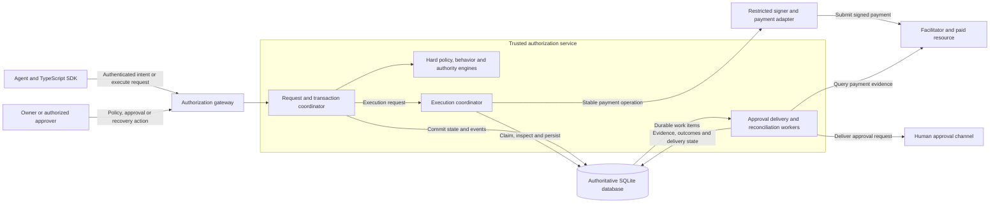
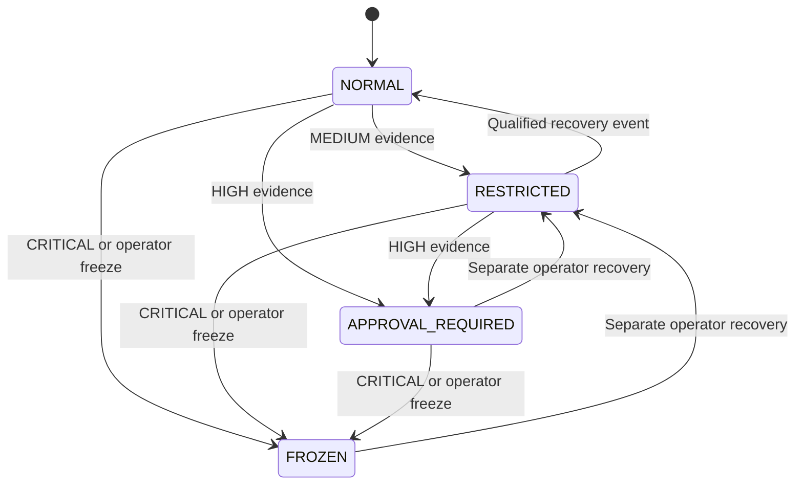
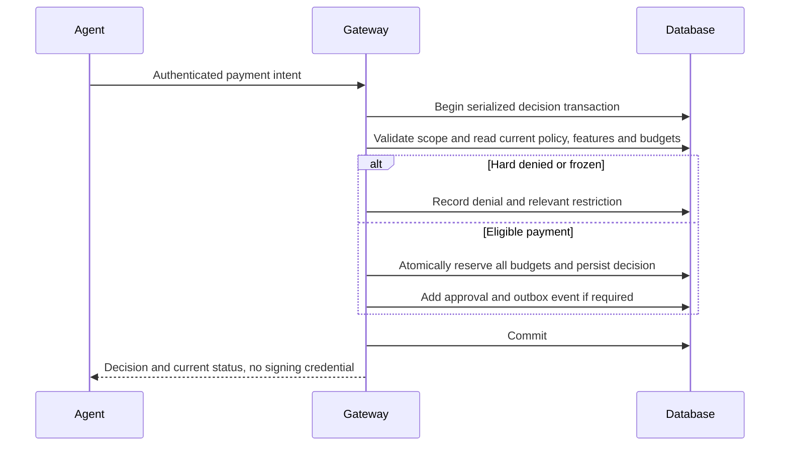
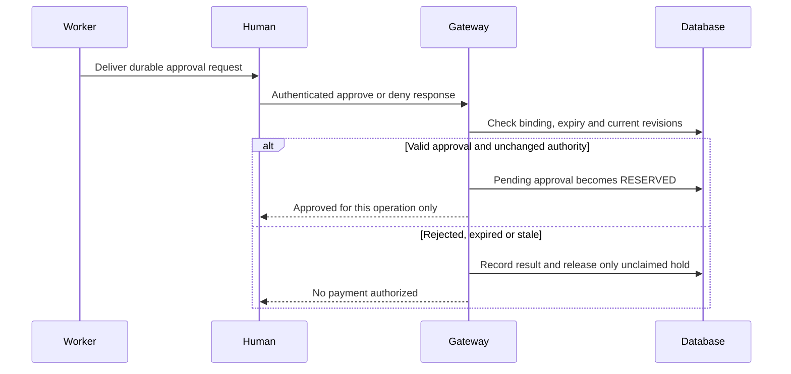
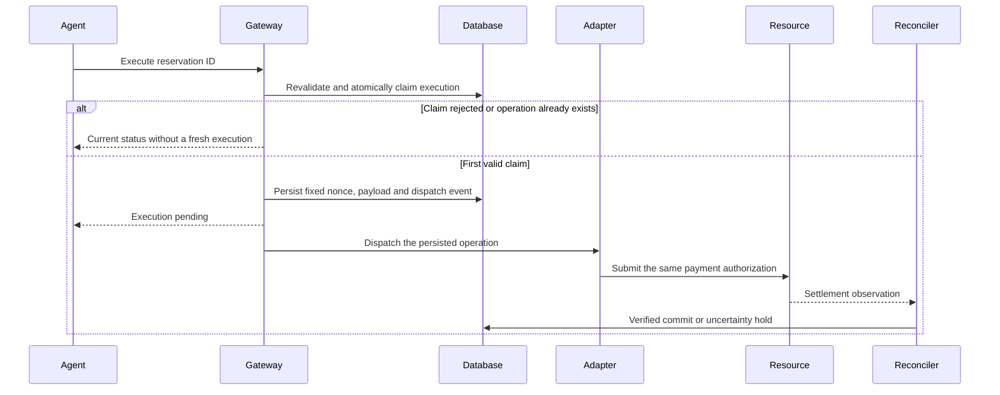
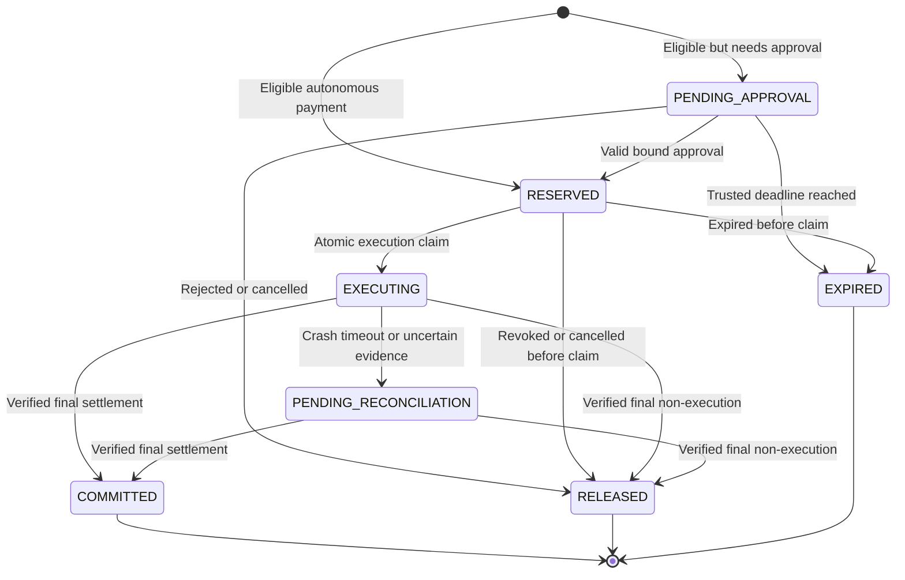

# PennyWise — Core Authorization Design

**Status:** Proposed design, revised 11 October 2026. No executable implementation or proven security guarantees exist yet.

**Scope:** One TypeScript gateway and authoritative store, deterministic adaptive authority, durable approvals, a mock x402 profile, and one external sandbox/testnet integration before the first complete release. All APIs below are proposed contracts or pseudocode; no hosted wallet provider is selected.

[How PennyWise works](how-pennywise-works.md) · [Project overview](../README.md) · [Contribution guide](../CONTRIBUTING.md)

## Contents

- [1. Product and boundaries](#1-product-and-boundaries)
- [2. Architecture](#2-architecture)
- [3. Invariants](#3-invariants)
- [4. Core engines](#4-core-engines)
- [5. Budgets and dynamic authority](#5-budgets-and-dynamic-authority)
- [6. Reference adaptive policy](#6-reference-adaptive-policy)
- [7. Requests and public contracts](#7-requests-and-public-contracts)
- [8. Authorization algorithm](#8-authorization-algorithm)
- [9. Approval and recovery](#9-approval-and-recovery)
- [10. Execution and revocation](#10-execution-and-revocation)
- [11. Settlement and reservation lifecycle](#11-settlement-and-reservation-lifecycle)
- [12. Storage and transactional events](#12-storage-and-transactional-events)
- [13. Authorization guards](#13-authorization-guards)
- [14. Decision records and audit boundaries](#14-decision-records-and-audit-boundaries)
- [15. Failure handling](#15-failure-handling)
- [16. Scenarios and expected results](#16-scenarios-and-expected-results)
- [17. Implementation phases](#17-implementation-phases)
- [18. Evaluation](#18-evaluation)
- [19. Deferred scope and release gates](#19-deferred-scope-and-release-gates)
- [20. References](#20-references)

## 1. Product and boundaries

PennyWise adaptively authorizes agent transactions using observed behavior and financial exposure, while enforcing owner-defined limits and accounting for unresolved payments. This document specifies the implementation. The [goals and success criteria](how-pennywise-works.md#1-objective-and-success-criteria) define the fixed objective: contain unwanted spending while preserving useful autonomy.

Every feature must strengthen authorization, exposure accounting, adaptation, approval safety, or evidence of those properties. Wallet/provider choice is infrastructure, not a change to this objective.

Three controls remain separate:

1. **Hard ceiling:** absolute transaction, budget, recipient and capability constraints.
2. **Autonomous allowance:** the subset currently permitted without human approval.
3. **Approval eligibility:** which payments inside the hard ceiling may proceed with an authenticated human decision.

The outcome is `ALLOW`, `DENY`, or `REQUIRE_APPROVAL`. The wallet remains responsible for custody and signing. The agent never gets an unrestricted signing tool in the reference deployment.

### Deployment modes

**Reference enforcement deployment:** The gateway, database, workers and signer credentials run outside the agent's process and writable directories. The gateway is the exclusive signing path. Payment execution is requested through an authenticated service endpoint, never by calling the signer directly.

**Embedded guardrail deployment:** The same core modules can run in the host application. This protects only operations routed through them. Compromised host code with another signing path is outside its guarantees.

The reference gateway protects against a compromised agent, not a compromised gateway administrator, database administrator, signer provider or host operating system. Those trusted components are explicitly inside the trusted computing base.

### Initial payment boundary

Support x402 `exact` using the EIP-3009 transfer method, one configured network and one asset. Begin with a protocol-shaped mock signer, facilitator and resource. Pin the protocol/SDK versions when implementation begins and reject other schemes and transfer methods.

The pure policy core consumes normalized payment fields, not provider SDK objects. A hosted wallet can supply the execution adapter only if it supports the bounded debit, fixed payment identity, restricted credentials and verified outcome requirements below. Provider independence is an architectural boundary, not a promise of compatibility with every wallet or payment rail.

The service reserves the maximum agent-funded debit defined by the adapter. The first mock profile has no agent-funded network fee. Any later adapter with fees must reserve a known upper bound in every affected asset or reject the operation.

Arbitrary contract calls, token allowances, bridging, unknown assets, cross-asset valuation and alternate signing routes are outside version 1.

## 2. Architecture

Use one service with logical modules, not separate microservices for each engine. SQLite holds authoritative policy snapshots, ledger state, operational aggregates, baseline versions, approval records, audit events and the outbox.



The agent sees scoped decisions and status, not database access, signer credentials or approval-administration endpoints. Human responses return through the authenticated gateway.

The adapter returns normalized observations. Reconciliation verifies their provenance and meaning before changing financial state. Background work can run in the gateway process initially; its durable records must survive that process.

## 3. Invariants

These are requirements for implementation and tests.

| ID | Requirement |
|---|---|
| INV-01 | A newly accepted reservation fits every applicable hard budget in one atomic transaction. |
| INV-02 | Live holds remain exposure regardless of their age or time-window rollover. |
| INV-03 | Within its authenticated scope, an idempotency key identifies exactly one canonical intent digest. |
| INV-04 | One reservation binds one execution identity, one payment nonce and one immutable payment payload. |
| INV-05 | At most one new execution claim succeeds for a reservation; retries do not create a new payable operation. |
| INV-06 | An execution claim revalidates policy, delegation, expiry, current authority, payload and approval. |
| INV-07 | Approval authorizes one operation; it neither overrides hard policy nor recovers authority. |
| INV-08 | Once execution may have occurred, exposure is released only on validated proof of non-execution or final non-redeemability. |
| INV-09 | Agents cannot administer policy, authority, baseline, approvals or settlement evidence. |
| INV-10 | Decisions, reservations, authority changes and durable events commit together or not at all. |
| INV-11 | Audit and baseline inputs have stable versions and deterministic serialization. |
| INV-12 | A freeze prevents execution claims ordered after it; previously claimed or issued payments remain conservatively accounted for. |

INV-01 is an admission guarantee, not a claim that lowering a budget can undo previous commitments. When a new limit is lower than existing exposure, headroom is zero and no new reservation is admitted.

Guarantees assume all relevant payment authority is routed through the service. An unrelated wallet owner can spend outside the service; that must either be excluded by deployment or accounted for through a separate integration. No exactly-once distributed execution guarantee is inferred from database atomicity alone.

## 4. Core engines

| Engine | Input and output | Responsibility |
|---|---|---|
| Request boundary | Credentials and wire intent → trusted principal and canonical intent | Authenticate, resolve delegation ownership, validate shape and limits, compute digest. |
| Hard-policy engine | Canonical intent, policy snapshot and budget state → prohibitions and approval requirements | Enforce transaction, recipient, network, capability and budget restrictions. |
| Behavior engine | Operational window, active baseline and current intent → versioned signals | Compute velocity, amount deviation and recipient familiarity deterministically. |
| Authority engine | Signals and persisted state → tighter state and autonomous allowance | Apply precedence, restrictions, cooldowns and explicit recovery rules. |
| Reservation ledger | Scoped debit and all budget accounts → hold or denial | Atomically check headroom, persist allocations, commit verified spend and safely release holds. |
| Approval broker | Pending reservation → authenticated, bound approval record | Durable notification, expiry, approver authorization, duplicate handling and revalidation. |
| Execution coordinator | Reservation ID → stable execution operation | Revalidate, claim once, persist nonce/payload, dispatch and recover without a fresh debit. |
| Settlement reconciler | Durable operation plus verified external evidence → ledger transition | Establish settlement or non-execution; retain uncertain exposure. |
| Audit recorder | Decision and state transition → durable ordered event | Preserve policy provenance, explanations, and evidence references. |

The SDK exposes proposed `authorize`, `execute` and `getStatus` methods. Approval, recovery and policy administration have separate authenticated APIs. The agent-facing SDK has no `release`, `commit` or raw-signing method.

## 5. Budgets and dynamic authority

### Scope and identity

Resolve owner, wallet, agent and delegation from credentials and protected records. A caller may request a delegation identifier, but the gateway must verify ownership before any lookup that exposes another scope's records.

Budget accounts have an explicit owner and scope: wallet, agent, delegation and optionally owner-issued task. Every request checks all applicable ancestors. A new task or delegation must not reset a shared wallet ceiling.

Asset identity is a canonical network plus asset identifier, not a ticker. Version 1 rejects any asset/network outside the configured profile; amounts in unlike assets are never added together.

### Exposure calculation

For every budget account `b` at trusted transaction time `t`:

```text
committed(b, t) = sum of verified debit events in (t - window(b), t]
outstanding(b)  = sum of live holds allocated to b, regardless of hold age
headroom(b, t)  = max(0, hardLimit(b) - committed(b, t) - outstanding(b))

Accept a new hold H only when H <= headroom(b, t) for every applicable b.
```

On settlement, move the hold to one committed event atomically; never count both copies. Use the time the verified settlement is recorded locally for version 1 budget accounting, not an untrusted remote timestamp. Preserve the actual provider/block time as separate evidence. This conservative rule keeps delayed settlements counted for a full configured window after reconciliation.

All active states, including `PENDING_APPROVAL`, `RESERVED`, `EXECUTING` and `PENDING_RECONCILIATION`, retain a hold. Advancing a clock or changing a budget window never releases it. No automatic budget restoration on refunds in version 1; refunds are separate records pending explicit policy design.

### Autonomous allowance and approval

Autonomous transaction allowance is the minimum of the hard transaction ceiling, configured autonomous ceiling, state ceiling and any cold-start ceiling. A payment above the autonomous allowance can require approval only if it still passes every hard rule and the policy explicitly permits approval.

Version 1 changes autonomous transaction allowance and approval requirement only; hard rolling-budget ceilings stay fixed until an authorized policy update. Adaptive changes must not erase prior spend or outstanding exposure.

Do not automatically override a hard ceiling after approval. Changing it requires a separately authorized policy revision.

### Policy versioning

Policy versions are immutable snapshots; owners can activate a new version. Active-version changes, revocation, freezes and execution claims are ordered through database transactions. Increment policy/authority revisions as appropriate and record them in every operation.

Version 1 invalidates unclaimed reservations and approvals when their policy digest changes. Cancel their unclaimed holds, then require a new logical request and approval under the new policy. Previously claimed operations retain their exposure until reconciled.

## 6. Reference adaptive policy

This is a proposed, reproducible demonstration profile named `adaptive-demo-v1`. Its numerical thresholds are illustrative, not validated production defaults. Adaptive mode is opt-in. Static mode retains hard policy, accounting, explicit approvals and emergency revocation.

### Configuration

| Setting | Example value |
|---|---|
| Unit | Six-decimal mock token; $1 in examples means 1,000,000 atomic units |
| Hard transaction ceiling | $20 |
| Hard rolling 24-hour wallet budget | $100, also checked alongside any agent/delegation budgets |
| Normal autonomous ceiling | $10 |
| Restricted autonomous ceiling | $2 |
| Cold-start autonomous ceiling | $1 and owner-vetted recipient only |
| Pending approvals | Maximum 3 per agent and 10 per wallet; their full holds consume hard budget |
| Approval expiry | 5 minutes or earlier intent/delegation expiry |
| Payment validity | At most 60 seconds, bounded by the remaining intent/delegation validity |
| Velocity window | (now - 60 seconds, now], including the candidate once |
| Baseline sample requirements | At least 20 owner-reviewed eligible observations; use the last 100 accepted observations |
| Recovery cooldown | 15 minutes without MEDIUM/HIGH/CRITICAL evidence or open incidents |

Request expiry is clamped by server policy. Approval expiry, intent expiry and payment-signature expiry are distinct fields. The signer never extends validity on a retry.

### Operational counters versus baseline observations

Operational counters track each new authenticated logical payment request, including hard-denied requests, plus failures and idempotency conflicts. A valid same-key/same-digest retry does not increment logical payment velocity. Separate ingress rate limits handle repeated HTTP calls, malformed input and oversized bodies.

Baseline data is separate. A completed payment is eligible for candidate review only if it settled, originated in `NORMAL`, used a vetted recipient, had no anomaly/approval/incident flags and passes provenance checks. Eligibility is not proof of benign intent.

Version 1 uses an immutable active baseline version, promoted by an operator from reviewed candidates. It does not automatically learn away anomalies. Live behavior and authority still change automatically relative to this baseline. Automatic rolling-baseline promotion with bounded influence is deferred to an independently evaluated extension.

### Exact signal rules

All money calculations use integers. Ratios are evaluated by cross-multiplication, not lossy conversion of large `bigint` values to JavaScript `number`.

| Signal | Deterministic rule |
|---|---|
| Velocity | Candidate-inclusive count in 60 seconds: 0–5 → NONE; 6–10 → MEDIUM; 11 or more → HIGH. |
| Amount deviation | Let m be the lower median of accepted baseline amounts; d = max(lower median absolute deviation, 100,000 atomic units). If amount > m + 6d → HIGH; else if amount > m + 3d → MEDIUM; otherwise NONE. |
| Recipient familiarity | Recipient forbidden by hard policy → DENY. Otherwise a recipient absent from the owner-vetted set → HIGH and eligible approval if configured. A one-off approval does not add the recipient to the vetted set. |

With fewer than 20 baseline observations, amount deviation returns `INSUFFICIENT_HISTORY`, not NONE. The cold-start allowance applies regardless of the named authority state. Velocity and recipient checks still run.

Baseline identity includes the protected owner/wallet/agent/delegation scope, asset/network, algorithm version and baseline version. A baseline cannot be borrowed from an unrelated agent.

### Combining signals and changing authority

Apply the highest severity; never average a strong signal away. Hard prohibitions remain terminal regardless of severity.

- NONE: retain state; evaluate the current autonomous ceiling.
- MEDIUM: escalate `NORMAL` to `RESTRICTED`.
- HIGH: escalate `NORMAL` or `RESTRICTED` to `APPROVAL_REQUIRED`.
- CRITICAL: enter `FROZEN`. In this example, a dedicated incident rule produces CRITICAL after three authenticated same-key/different-digest conflicts in 60 seconds within the principal's scope. Operator emergency freeze is also supported.

Unauthenticated traffic cannot increment another agent's incident counters. Conflicts are recorded separately from valid retries. This critical rule can still cause denial of service after credential compromise; evaluate that cost explicitly.

Restriction is monotonic during ordinary authorization: a clean request never silently lowers the persisted state. A hard denial is recorded with operational counters and incident-driven restriction updates, but never creates a hold. Failure to reserve budget must not roll back an independently justified restriction; use typed denial outcomes within the transaction instead of throwing away the whole decision.

### Recovery

Payment approval and rejection do not change authority. Approval timeout alone does not freeze an agent.

A recovery worker may move `RESTRICTED` to `NORMAL` only after the configured cooldown, at least 10 qualifying confirmed low-risk purchases since entering restriction, sufficient baseline history, no unresolved payment or incident, and an explicit policy enabling automatic recovery. Qualifying recovery purchases must be autonomous purchases within the restricted allowance, to vetted recipients, with NONE for every available behavior signal and sufficient history for the amount signal. Each distinct settled execution counts once. These purchases are recovery evidence, not baseline-training candidates: baseline eligibility still requires origin in `NORMAL`. Idle time alone is insufficient. Otherwise an operator action is required.

`APPROVAL_REQUIRED` and `FROZEN` require separate operator-authorized recovery to `RESTRICTED` in version 1. The operator records a reason, checks current policy and incidents, and increments the authority revision. Approval permission does not imply recovery permission.



### Worked trace

Assume a mature agent, a vetted recipient and a baseline that considers $1 normal. Six distinct $1 requests within 60 seconds move the agent to `RESTRICTED` on the sixth request; $1 remains within the $2 restricted allowance. The eleventh distinct request moves it to `APPROVAL_REQUIRED` and creates a pending approval if hard headroom and queue capacity remain.

Approving that eleventh request allows its execution after revalidation. The state stays `APPROVAL_REQUIRED`. An $8 purchase in `RESTRICTED`, with no stronger anomaly, requires approval; a $21 purchase is denied by the hard ceiling. Retrying an existing logical request changes neither its hold nor its payment nonce.

## 7. Requests and public contracts

The following types are illustrative contracts for the first x402 gateway profile, not provider-independent core types or a runnable SDK. Runtime schemas, adapter fixtures and migrations will be implemented together; the core consumes validated normalized fields.

```ts
interface PaymentIntentWire {
  schemaVersion: "1";
  idempotencyKey: string;
  delegationId: string; // selected by caller, verified against credentials
  taskId?: string;      // optional owner-issued task, never a fresh budget root
  network: string;
  asset: string;
  amountAtomic: string; // canonical positive base-10 integer, no exponent/sign
  recipient: string;
  scheme: "exact";
  transferMethod: "eip3009";
  resourceUrl: string;
  method: "GET" | "POST";
  bodyDigest?: string;
  paymentChallenge: unknown; // validated and normalized by the adapter
  expiresAt: string;
}

interface TrustedScope {
  ownerId: string;
  walletId: string;
  agentId: string;
  delegationId: string;
}

type ReservationState =
  | "PENDING_APPROVAL" | "RESERVED" | "EXECUTING"
  | "PENDING_RECONCILIATION" | "COMMITTED" | "RELEASED" | "EXPIRED";

type Decision =
  | { kind: "DENY"; decisionId: string; reasonCodes: string[] }
  | { kind: "ALLOW"; decisionId: string; reservationId: string }
  | {
      kind: "REQUIRE_APPROVAL";
      decisionId: string;
      reservationId: string;
      approvalId: string;
    };
```

Every stored decision additionally has request/policy digests, baseline and algorithm versions, authority revisions, evaluated features, trusted evaluation time and reason evidence. A status response carries the original decision alongside the **current** reservation state. An ALLOW decision is not a bearer signing credential.

### Canonicalization and request binding

Use a versioned, deterministic encoding with domain separation. Reject duplicate JSON keys, ambiguous numbers, invalid addresses, unknown security fields and unsupported schemes. Convert decimal strings to bounded integers internally; serialize them as canonical strings for hashing and APIs.

The intent digest binds trusted scope, all financial fields, resource origin/path, HTTP method, request-body digest where relevant, selected payment requirement, and intent expiry. Omit tracing request IDs and the idempotency key from the payment semantics; store them separately. The same scoped key with a different digest is a conflict, not a new authorization.

Digest resource context to bind local authorization to a purchase. Do not claim that EIP-3009 itself cryptographically binds the resource URL or HTTP body; its signed fields cover payment authorization. Merchant fulfillment guarantees are outside that signature and outside this project's enforcement claim.

Idempotency uniqueness is `(ownerId, walletId, agentId, delegationId, idempotencyKey)`. Retain used-key tombstones through at least the delegation lifetime and every operation's final resolution. Never silently reuse a settled key for a new purchase.

### Proposed endpoints

| Caller | Operation | Effect |
|---|---|---|
| Agent | `authorize(intent)` | Decision and optional reservation; no signing. |
| Agent | `execute(reservationId)` | Claim or return existing execution status; caller cannot replace the payload. |
| Agent | `getStatus(id)` | Read only records within authenticated scope. |
| Approver | `decideApproval(id, response)` | Authenticated one-operation approval or rejection. |
| Operator | `freeze`, `recover`, `activatePolicy` | Separate administration permissions and audit records. |
| Internal worker | `reconcile(executionId)` | Verify evidence and apply idempotent ledger transitions. |

## 8. Authorization algorithm

Evaluate security-critical features and reserve against the same serialized state. Signing and provider calls never occur inside this transaction.

```ts
async function authorize(raw: unknown, credentials: Credentials) {
  const principal = await authenticate(credentials);
  const validated = validateWireIntent(raw);
  // Malformed authenticated attempts go to separate bounded ingress counters.

  return store.transaction(async tx => {
    const now = tx.trustedNow();
    const scope = await tx.resolveOwnedDelegation(principal, validated);
    const intent = canonicalize(scope, validated);
    const digest = hashIntent(intent);
    const prior = await tx.findIntent(scope, validated.idempotencyKey);

    if (prior) {
      if (prior.digest !== digest) {
        return tx.recordConflictAndApplyIncidentRules(scope, now);
      }
      // Authenticated historical status only; does not renew permission.
      return tx.currentStatus(prior);
    }

    await tx.recordLogicalAttempt(scope, intent, now); // exactly once
    const snapshot = await tx.loadDecisionSnapshot(scope, intent, now);
    const hard = evaluateHardRules(intent, snapshot);
    const incident = evaluateIncidentRules(snapshot);

    // Incidents can tighten state even when this payment is hard-denied.
    let authority = tightenAuthority(snapshot.authority, incident);
    if (hard.denied || authority.state === "FROZEN") {
      return tx.persistDenialAndAuthority(intent, hard, authority);
    }

    const signals = snapshot.policy.adaptive.enabled
      ? evaluateSignals(intent, snapshot)
      : [];
    authority = tightenAuthority(authority, signals);
    await tx.persistAuthority(authority);

    const decision = resolvePaymentDecision(intent, hard, authority, snapshot);
    if (decision.kind === "DENY") {
      return tx.persistDenial(intent, decision);
    }

    // Returns a typed denial rather than throwing for ordinary no-headroom.
    const hold = await tx.tryReserveAllApplicableBudgets({
      scope, intent, authority, decision, now,
    });
    if (!hold.accepted) return tx.persistDenial(intent, hold.reason);

    return tx.persistDecisionReservationApprovalAndOutbox({
      scope, intent, digest, decision, authority, hold, snapshot,
    });
  });
}
```

The snapshot includes the candidate attempt once, the active immutable baseline, every applicable budget account and all policy/revocation revisions. The storage adapter enforces serialization and uniqueness; naming a method `transaction` is not sufficient.

Transient transaction failures roll back every database effect and retry with the same scoped idempotency key under a bounded retry policy. No external side effects are performed before commit.



## 9. Approval and recovery

Approval requests are created in the same transaction as their pending hold and outbox event. Notification delivery is at least once; delivery IDs and approval responses are deduplicated.

Bind each approval to approval ID, reservation ID, trusted scope, intent digest, policy digest, exact maximum debit, permitted approver set, issuance authority revision and expiry. A response needs authenticated identity and replay protection; deployment may use signed responses or a protected authenticated channel.

An approval response transaction:

1. Resolves the responder's permission for this exact scope; agent credentials cannot qualify.
2. Checks pending state, nonce/response identity, digest bindings and trusted expiry.
3. Loads current delegation, policy and authority.
4. Rejects stale approvals after a policy or authority revision change; release/cancel only unclaimed holds.
5. For a valid rejection, releases the unclaimed hold.
6. For a valid approval, changes `PENDING_APPROVAL` to `RESERVED` without changing authority.
7. Persists the response and event atomically.

Matching duplicate responses return existing status. Conflicting responses cannot reverse an earlier result. A timeout races with approval through the same compare-and-set state check. No signature exists for a pending approval.

Unauthenticated or unauthorized responses cannot cancel a reservation, release its hold or change its authority. Record them in a separate bounded security log; only a permitted responder or trusted expiry/revocation worker can make a lifecycle transition.

Pending capacity is bounded by both count and value at agent and shared-wallet scope. Notifications are rate limited; the agent cannot choose an approver webhook destination.



Neither branch invokes signing directly. A subsequent execution claim performs another current-state check. Recovery uses a different permission, endpoint and audited reason; an approval is never a recovery event.

## 10. Execution and revocation

### Claim before external execution

The agent requests execution by reservation ID. It cannot supply replacement financial fields. The coordinator:

1. Resolves ownership and loads the persisted canonical intent.
2. Returns status if an execution already exists; it does not allocate a new nonce.
3. Revalidates expiry, active delegation/policy, current authority, applicable hard limits and approval.
4. Checks the current autonomous ceiling for an unapproved operation. If it now needs approval, cancel the unclaimed operation and require a new request.
5. Atomically changes `RESERVED` to `EXECUTING` and creates a unique execution row.
6. Persists execution ID, payment nonce, fixed validity interval, exact signing payload/digest, maximum debit, signer identity and all revisions.
7. Commits an execution-dispatch outbox event with that state.

The reservation already owns its hold; this transaction does not reserve or subtract it again. Budget revalidation excludes double-counting that hold but includes all outstanding obligations.

One unique execution per reservation is enforced by the database. Stable nonce and payload are persisted before calling the signer. Attempt IDs may distinguish retries, but execution identity never changes.

### Dispatch, retries and process failure

The trusted adapter signs only the persisted payload and verifies the returned signature against the intended wallet and payload. Store the signature or retrieval reference securely before submission when possible. Never log a reusable raw signature in public audit exports.

Use the same nonce, validity interval and signed message on recovery. EIP-3009 supplies single-use authorization nonces; duplicate submission of the same authorization must not become a second payable authorization. A signature can differ in byte representation while authorizing the same immutable message; the nonce and message are the debit identity.

Workers use durable leases and fencing versions to coordinate retries. A lease expiry does not release the financial hold. If signing may have occurred but the result was lost, inspect or retry only the exact stable operation; if the adapter cannot establish safe semantics, retain uncertainty for reconciliation. Adapters without idempotent or inspectable behavior are unsupported in version 1.



### Freeze ordering and policy updates

The execution-claim commit is the admission boundary for version 1. A freeze or revocation committed first blocks the claim. A claim committed first may still execute: its exposure was admitted before the freeze and stays held.

Workers should stop a pre-freeze queued operation when they can prove no signing or dispatch began. Otherwise they must conservatively treat it as potentially issued. Do not claim instantaneous revocation of a signed payment.

Execution relies on current authoritative state, not a portable permission token that could outlive a freeze.

## 11. Settlement and reservation lifecycle



### Evidence requirements

Only the internal reconciliation path can commit or release an executed operation. Evidence is tied to execution ID, network, asset, wallet, recipient, exact value and nonce. Verify provider identity and evidence authenticity; arbitrary agent reports are hints for investigation, not proof.

Distinguish payment settlement from service delivery. A resource error after successful payment still produces committed spend. A refund, application error or failed HTTP response does not erase the original debit.

The adapter defines finality and evidence validation. A real-chain adapter must document confirmation/reorganization handling before use; the mock adapter uses a durable simulator ledger and explicit final outcomes. RPC outage or conflicting evidence leaves exposure held.

Before releasing after payment validity expires, establish both that it cannot be redeemed in the future and that it did not settle earlier. Time passing alone proves neither complete history nor finality. A failed broadcast attempt does not prove that another submission of the same signed authorization cannot succeed.

Idempotent duplicate settlement receipts do not double-commit. Evidence contradicting a terminal outcome triggers an incident and blocks new spending in affected scope pending reconciliation; terminal-state correctness must be tested before release.

### Exception and orphan recovery

Any timeout or exception after execution claim is potentially ambiguous. Persist `PENDING_RECONCILIATION` when possible. A periodic sweeper finds stale `EXECUTING` records if the process dies before that write. Neither the agent nor a generic TTL sweeper may free such holds.

Never-claimed reservations can expire or cancel atomically because only `EXECUTING` permits signing. Test expiry versus claim races against the real store.

## 12. Storage and transactional events

The [technology decision record](technology-decisions.md#1-why-sqlite-first-rather-than-postgresql) explains the SQLite-first, single-host boundary and when PostgreSQL is the better deployment choice. Store interchangeability means preserving the invariants through adapter-specific transactions and tests, not substituting a database URL. No database is required in Phase 0.

### Tables and ownership

| Logical table | Important fields or constraints |
|---|---|
| `policies` | Immutable digest/version, owner, active pointer, approval and hard rules |
| `delegations` | Owner/wallet/agent binding, permitted scope, expiry and revocation revision |
| `authority_states` | Protected principal scope, state, revision, entry time, recovery counters |
| `budget_accounts` | Scope hierarchy, network/asset, rolling window, hard ceiling and revision |
| `payment_intents` | Scoped unique idempotency key, canonical digest and immutable request |
| `reservations` | Intent binding, lifecycle state, maximum debit and expiry |
| `reservation_allocations` | Hold membership in every applicable budget account |
| `execution_attempts` | One execution per reservation, fixed nonce/payload, lease/fence and evidence refs |
| `approvals` | Bound request, allowed responder set, revision, expiry and response |
| `behavior_features` | Operational counters and consistent event cursor; no cross-tenant lookups |
| `baseline_versions` | Reviewed observation provenance, immutable statistics and algorithm version |
| `decision_events` | Ordered durable decisions, transition evidence and protected audit payload |
| `outbox_events` | Unique event ID, payload/ref, delivery state and retry metadata |

The list describes logical responsibilities, not a finalized migration. Storage must preserve all uniqueness and transaction requirements even if some tables are combined.

### Atomicity

Use an adapter that implements serialized decision-and-reservation transactions. For SQLite, implement write transactions with `BEGIN IMMEDIATE`, uniqueness constraints and bounded busy retries. Exercise separate connections and processes, not just an in-process mutex. No network calls inside a transaction.

Revision counters change on policy activation, authority transition and explicit invalidation events, not on every status read or harmless repeated request. This prevents unrelated reads from needlessly invalidating pending approvals.

Budget checks, relevant operational counters, authority changes, reservation allocations, decisions and outbox writes use the same database transaction. Approval and execution updates also use compare-and-set lifecycle checks. Rebuild behavior features from durable events; a missing or inconsistent security-critical feature snapshot fails closed rather than silently becoming a safe baseline.

Notifications and metrics export happen after commit. Consumers deduplicate event IDs. A transactional outbox avoids losing an event between a successful database write and a failed notification call; it does not make external payment systems part of the database transaction.

### Recovery and scale

A process restart reopens the same durable database and resumes outbox, expiry and reconciliation work. Restoring an old backup can erase knowledge of issued signatures; require a spending pause and reconciliation before admitting new operations after rollback recovery.

Version 1 is a single-host reference deployment. Independent SQLite copies must never each authorize against the same wallet budget. Multi-host scale requires a shared store implementing the same contract and concurrency tests. The memory adapter is for tests; it cannot recover real payment authority after a restart.

## 13. Authorization guards

| Order or boundary | Guard | Failure outcome |
|---|---|---|
| Ingress | Caller authentication, body size, input schema and rate limit | Reject without attributing activity to an unauthenticated victim |
| Scope | Credential-bound owner, wallet, agent and delegation | Deny cross-scope access |
| Idempotency | Scoped key and canonical digest | Return current historical status or record conflict |
| Hard policy | Allowed network/asset/scheme/recipient, expiry and absolute ceilings | Deny; never override through approval |
| Behavior | Candidate-inclusive operational window, versioned baseline and insufficient-history rules | Tighten state/allowance or require approval |
| Budget | Every ancestor's committed spend plus all live holds | Atomic hold or typed denial |
| Approval | Exact binding, permitted responder, expiry, current policy and authority revisions | Reject stale/forged response; do not sign |
| Execution | Ownership, current policy, authority, approval and unique execution claim | No new operation on denial or duplicate |
| Signer | Persisted exact payload, stable nonce, domain and signer binding | Refuse changed payload |
| Settlement | Validated matching evidence, finality and non-redeemability | Commit, verified release, or retain uncertainty |
| Recovery | Separate permission or explicit qualified cooldown rule | No implicit recovery from a payment approval |
| Audit | Transactionally durable event, stable encoding, policy and evidence references | Explain decisions and reconstruct known operations; no administrator-tampering guarantee |

## 14. Decision records and audit boundaries

First preserve durable events in the authoritative transaction. Record request and policy digests, baseline/algorithm version, relevant features, authority revisions, reservation/execution IDs, reasons and evidence references. Exclude credentials and reusable payment signatures from ordinary logs.

Serialize event ordering in the authoritative store and define redaction before persistence. Link each decision to the exact policy version and operation so an operator can explain why a payment was allowed, denied, or held for approval. Export and notification retries use durable event IDs; they do not change financial outcomes.

These records are for debugging, reconciliation, and evaluation. They do not make history tamper-proof against a database or host administrator. If an old database backup is restored or relevant history is known to be missing, pause new spending and reconcile outstanding authorizations before resuming. Detection of arbitrary privileged rewriting is not an implemented or promised capability.

Behavior calculations use indexed time windows and stored aggregates. Audit storage is not the behavioral algorithm.

## 15. Failure handling

| Failure | Required handling |
|---|---|
| Duplicate agent HTTP request | Return current status; no duplicate hold, logical-attempt count or payment nonce |
| Cross-scope record lookup | Deny before disclosing whether another scope's record exists |
| Unavailable policy/store or inconsistent critical features | Reject new authorization/execution; do not sign |
| Insufficient budget or approval capacity | Persist typed denial and any justified restriction; no hold |
| SQLite contention | Bounded retry of the transaction, then explicit unavailable status |
| Crash after approval reservation commit | Outbox redelivers the same approval event |
| Approval races with timeout | One state transition wins; stale result cannot revive the hold |
| Crash after execution claim | Sweeper finds durable operation and reconciles/retries the same nonce only |
| Signature returned but process crashes before saving it | Inspect or retry exact fixed message; never allocate a replacement nonce |
| Application error after payment | Commit verified debit independently of fulfillment status |
| Provider reports failure but authorization remains usable | Hold and reconcile; do not release from the failed attempt alone |
| Freeze during approval or execution | Block claims after freeze; retain earlier potentially issued exposure |
| New policy lowers limit below exposure | Zero new headroom; cancel unclaimed stale-policy holds, retain claimed exposure |
| Audit export or approval channel unavailable | Retry durable events; no automatic payment or authority recovery |
| Database restored from stale backup | Pause new spending until outstanding operation history is reconciled |

## 16. Scenarios and expected results

Use fixed clocks, versioned fixtures and a durable mock provider ledger. Every case should assert financial balances, state transitions, reason codes and external payment identities, not only the returned decision.

| ID | Scenario | Required result |
|---|---|---|
| S01 | Mature agent makes a familiar, normal $1 purchase | Reserve → claim → verified commit; one nonce and one debit |
| S02 | Same scoped key and same intent retried | Same intent and current status; no new logical attempt or hold |
| S03 | Same scoped key reused for a changed amount | Conflict; no signing; authenticated incident count updated |
| S04 | Different principal guesses a reservation ID | No record disclosure or mutation |
| S05 | Two workers execute the same reservation concurrently | One claim and one debit identity; other worker returns existing status |
| S06 | Several requests race for the last $5 of a shared wallet budget | All scopes serialize against the shared account; total newly admitted holds fit |
| S07 | Agent creates another task or delegation | Cannot reset wallet budget or protected agent authority |
| S08 | A hold survives past a 24-hour window boundary | Still counted while live; rollover never frees outstanding exposure |
| S09 | Sixth then eleventh distinct normal request in 60 seconds | Restricted on sixth; approval required on eleventh under reference profile |
| S10 | Unknown recipient introduced through prompt injection | Hard-deny if forbidden; otherwise approval; text cannot override guards |
| S11 | Human approves one $8 request while agent is restricted | Only that operation can proceed; agent remains restricted |
| S12 | Operator freezes agent while human approval is pending | Late approval cannot authorize execution |
| S13 | Freeze commits before execution claim | Claim denied; no signer invocation |
| S14 | Freeze commits after claim/signature issuance | Potential debit remains held; no promise of recalling issued authorization |
| S15 | Adapter times out after submitting payment | Pending reconciliation; no fresh nonce and no released budget |
| S16 | Paid resource returns an error after successful payment | Debit remains committed; fulfillment failure recorded separately |
| S17 | Approval expires as another worker approves it | One atomic winner; no expired hold is revived |
| S18 | Attempted unlimited approval or arbitrary contract call | Unsupported capability denied before signing |
| S19 | Slow escalation or poisoned training candidates | Active baseline cannot auto-drift; measure false negatives rather than claiming complete prevention |
| S20 | Attacker floods pending approvals | Agent and wallet count/value bounds plus rate limits contain resource use |
| S21 | New policy invalidates an old unclaimed authorization | Historical decision remains visible; execute fails and requires new request |
| S22 | Process dies after any persistent or external boundary | Recovery follows stored operation without duplicate debit or unjustified release |
| S23 | Forged settlement failure from agent | Ignored as release authority; reconciliation requires validated evidence |
| S24 | Operator lowers a budget below already incurred exposure | No negative accounting or retroactive erasure; zero new headroom |
| S25 | Approval declined, human unavailable, or agent idle | No automatic freeze/recovery solely from these events |
| S26 | Operator restores an old database backup or discovers missing operation history | Restore/recovery procedure pauses spending until reconciliation; arbitrary privileged tampering is not claimed to be automatically detected |

Anomaly detection can miss malicious payments resembling normal purchases. Explicitly include those false-negative scenarios. The promised hard boundary is the configured policy and accounting invariant, not perfect knowledge of agent intent.

## 17. Implementation phases

This is the canonical six-phase roadmap. Tests grow with each phase; signer isolation enters with the first payment flow. README summarizes it; other guides link here rather than repeat acceptance gates.

The [Phase 0 development record](development/phase-0.md) is the canonical place for that phase's initial intent, detailed design, expected and actual outcomes, and verification evidence. Its toolchain uses Bun for package management, development execution, scripts, and tests, with separate TypeScript compiler checks. These are planned implementation choices, not installed capabilities.

| Phase | Work | Acceptance gate |
|---|---|---|
| 0 — Contracts and static policy | Bun/TypeScript workspace, host-supplied trusted scope, exact wire/canonical types, immutable policies, CI and policy tests; MIT license already added | Hard denials and ownership boundaries have deterministic fixtures; no credential authentication, reservations or signing yet |
| 1 — Ledger and execution safety | Memory/SQLite contract, shared budgets, scoped idempotency, unique execution claims, outbox and crash records | Real-store concurrency, rollover and duplicate-claim tests pass |
| 2 — Mock x402 payment | Isolated gateway, restricted mock signer, exact adapter, reconciler and example | S01/S05/S13–S16/S22 prove one debit identity and retained uncertainty |
| 3 — Durable approvals | Approval events, authenticated responses, pending caps, expiry and separate recovery APIs | S11/S12/S17/S20/S21/S25 pass with restarts and races |
| 4 — Adaptive authority | Three signals, reviewed baseline versions, reference policy and qualified recovery | Worked trace, cold-start tests and deterministic state transitions pass |
| 5 — Evaluation and adoption | Testkit, static comparisons, held-out scenarios, overhead measurements, one external sandbox/testnet adapter and contributor examples | Provider/network records reconcile with the ledger; evaluation and limitations reproducible; release docs match implemented behavior |

Select the external integration only after confirming access, sandbox/testnet support, debit bounds, retry semantics, credential isolation, status lookup and evidence/finality requirements. It validates the payment boundary; it does not replace mock fault injection or durable-store tests. Adaptation remains required for the first complete release even though adopters may disable it.

The smallest full demonstration is a normal purchase, a retry burst restricting autonomy, an unusual payment needing approval, and a freeze preventing a subsequent claim. Include concurrency and process-crash runs.

Suggested package boundaries:

```text
apps/gateway     API and durable workers
apps/example     Agent and mock resource
packages/core    Pure policy/behavior/authority logic and lifecycle contracts
packages/store   Transactions, migrations and memory/SQLite adapters
packages/x402    Challenge normalization, payload binding and adapter contract
packages/testkit Deterministic clocks, scenario traces and fault injection
```

## 18. Evaluation

Compare four configurations under the same hard ceilings, accounting, execution protections and workloads:

1. Basic static amount and time-window rules.
2. Static rules with velocity limits.
3. Contextual static rules with recipient controls and approval.
4. The same hard envelope plus behavior-dependent autonomy and persistent recovery state.

Tune thresholds on development workloads and report results on held-out benign and adversarial workloads. Match approval burden or plot its trade-off against task completion and loss; tighter blocking alone is not evidence of better adaptation.

Define acceptable task-completion and approval trade-offs before evaluating; do not invent a numerical improvement target without baseline evidence. The research question is whether adaptive authority improves that balance, not whether every abnormal-looking purchase can be detected.

Report loss before containment, time and transaction count before restriction, legitimate task completion, false blocks, approval frequency/latency, recovery time, unresolved exposure, and p50/p95 authorization latency with database contention. State the sample unit, seeds, hardware and uncertainty intervals where appropriate. Separate simulator claims from integration results.

Use ablations for amount deviation, novelty, velocity, persistence and recovery. Include attackers staying below thresholds, legitimate workload changes, poisoning, reset attempts and defensive denial of service. Negative results remain useful.

## 19. Deferred scope and release gates

The initial scope excludes custody infrastructure, trading, general agent orchestration, LLM-based authorization, dashboards, multiple external providers, automatic baseline promotion, extra assets/chains, arbitrary contract permissions, dynamic shared-window reductions, portable authorization proofs, and multi-host deployment. These are not commitments in the current roadmap.

Before executable public release:

- Retain the existing [MIT License](../LICENSE) and verify that dependency licenses and required notices are compatible with distribution.
- Configure a real private vulnerability-reporting channel.
- Publish pinned toolchain versions and commands that actually run.
- Pin the supported x402 version/scheme and document adapter evidence/finality assumptions.
- Verify all financial invariants on the durable store and mock provider.
- For the first complete release, verify one external sandbox/testnet integration, demonstrate adaptive restriction/recovery and approvals, and publish the static-versus-adaptive evaluation. A static-policy or mock-only milestone is not the complete project.
- Clearly distinguish guardrail mode from isolated enforcement and simulation from production readiness.

No real-fund safety claim is made by this document.

## 20. References

These sources informed the design review; links are references, not dependencies or independently verified implementation endorsements.

- [EIP-3009: Transfer With Authorization](https://eips.ethereum.org/EIPS/eip-3009) — authorization nonce, signed payment fields and validity.
- [x402 exact EVM specification](https://github.com/x402-foundation/x402/blob/main/specs/schemes/exact/scheme_exact_evm.md) — transfer methods and settlement observations. Pin a revision at implementation.
- [SQLite isolation](https://www.sqlite.org/isolation.html) — serialized writes and transaction behavior.
- [Transactional outbox guidance](https://docs.aws.amazon.com/prescriptive-guidance/latest/cloud-design-patterns/transactional-outbox.html) — durable state/event delivery boundaries.
