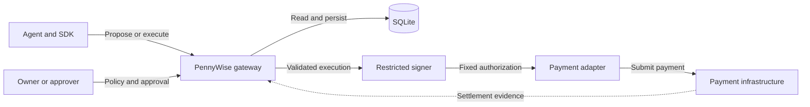
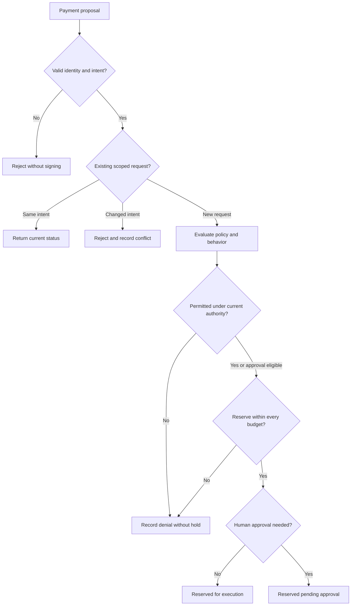
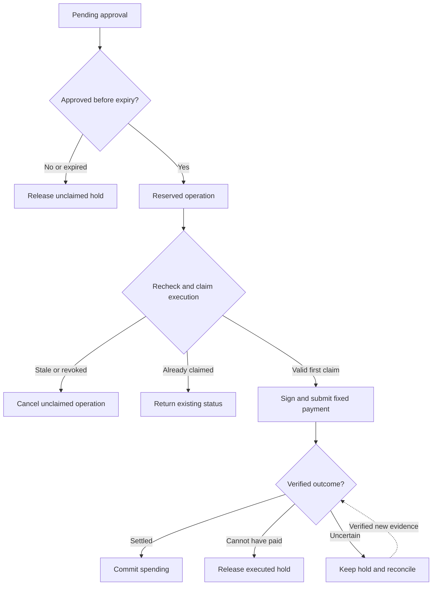
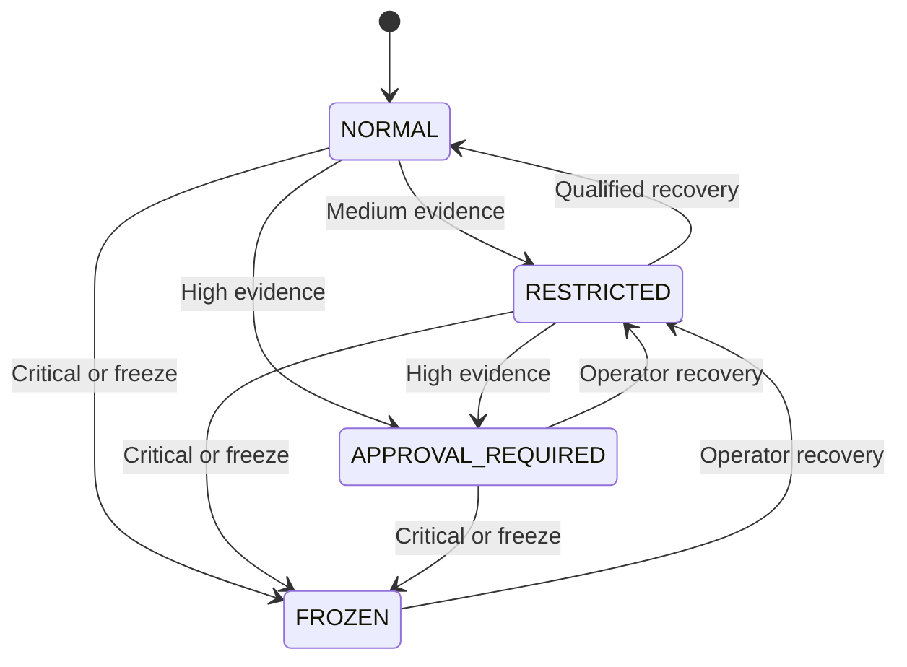

# PennyWise — Goals and Flow

> Adaptively authorize agent transactions using observed behavior and financial exposure, while enforcing owner-defined limits and accounting for unresolved payments.

**Status:** Phase 0 static core implemented; see the [development record](development/phase-0.md) for evidence. TypeScript is the product language and Bun the development toolchain. The complete authorization lifecycle below remains a design: no live budget, signer, approvals or adaptive enforcement exists yet.

[Engineering contract](core-authorization-design.md) · [Technology decisions](technology-decisions.md) · [Phase 0 record](development/phase-0.md) · [Contributing](../CONTRIBUTING.md)

## 1. Objective and success criteria

Give autonomous agents useful spending freedom while containing unwanted spending from runaway or compromised agents. Developers integrate the payment lifecycle; owners get shared-budget controls; operators get precise approvals and explanations; contributors get repeatable policy tests.

| Goal                       | Required evidence                                                                                                 |
| -------------------------- | ----------------------------------------------------------------------------------------------------------------- |
| Enforce owner limits       | Agent/adaptive engine cannot override caps or prohibited destinations; concurrent reservations fit shared budgets |
| Account for exposure       | Pending/uncertain payments remain counted; retries do not create another hold or debit identity                   |
| Adapt authority            | Defined signals tighten autonomous allowances or approval requirements; restrictions survive restart              |
| Make approval precise      | Consent binds one purchase, expires, respects hard limits, and does not restore general authority                 |
| Preserve useful autonomy   | Routine tasks can complete without unnecessary approval; recovery follows explicit qualifications                 |
| Explain and test decisions | Reasons, policy versions, exposure and authority are recorded; scenarios reproduce outcomes                       |

The research question is whether behavior-adaptive restrictions and controlled recovery reduce harmful spending **under the same hard limits** without unacceptable task failures or approval workload compared with strong static controls. This is not a claim of uniqueness or proven superiority.

**Scope rule:** every feature must strengthen authorization, exposure accounting, adaptation, approval safety, or evidence of those properties. Otherwise defer it.

## 2. Three separate controls

1. **Hard limits:** is the purchase permitted at all? Check amount, destination, asset/network, capability, delegation and budget.
2. **Autonomous allowance:** may this agent make that purchase without approval under its current authority?
3. **Approval eligibility:** may a permitted human approve this exact purchase inside the hard limits?

The wallet manages funds and signing. PennyWise controls access to that authority and accounts for the outcome; it does not decide what the agent should buy.

## 3. Architecture and integration boundary

One gateway with internal modules, one authoritative SQLite store, and restricted payment execution. The agent runs outside the trusted service:



The adapter and signer belong to the trusted service. Owners administer policy/delegation; approvers receive only their assigned permissions. Agents receive scoped decisions/status, never unrestricted payment credentials or database access.

Gateway enforcement requires exclusive execution credentials and no agent-accessible bypass. Embedded use is only a guardrail when host code can call the signer directly. Gateway/administrator/provider/host compromise is outside the threat model.

The first example is mock x402 `exact`/EIP-3009, one configured asset/network, with no real funds. A hosted wallet is a possible execution adapter—not a replacement for PennyWise's controller. No provider is selected. The core must not depend on provider SDK objects; adapters must supply bounded debit, stable retry identity and verifiable settlement/non-execution evidence. Universal wallet compatibility is not promised.

SQLite serves the single-host reference; memory is test-only. PostgreSQL is an alternative for a shared database across gateway hosts, not an automatic upgrade or a promised extra adapter. See [the database rationale](technology-decisions.md#1-why-sqlite-first-rather-than-postgresql).

## 4. Decide and reserve



One serialized transaction records logical activity, justified authority changes, decision, hold and durable events. Denial creates no hold but can tighten authority. Valid same-key/same-intent retries return current status without renewing permission or expiry.

For each applicable wallet/agent/delegation/task budget:

```text
headroom = max(0, hard ceiling - committed spend in window - all outstanding holds)
```

A $100 ceiling with $60 committed and $30 pending leaves $10. Approval-pending holds count; window rollover cannot release unresolved exposure. Lowering an owner limit below existing exposure leaves zero headroom rather than erasing obligations.

Use exact atomic-unit integers internally and decimal strings externally. Module responsibilities and the full transaction algorithm live in the [core design](core-authorization-design.md#4-core-engines).

## 5. Approve, execute and reconcile



Autonomous purchases enter directly at “Reserved operation.” An unanswered approval stays pending until trusted expiry; forged responses cannot release it. Consent binds scope, intent, debit, policy, authority revision, permitted approver and expiry. Stale approvals fail revalidation.

Execution rechecks current permission and atomically claims one operation. Persist its nonce, payload and validity before signing/network calls. Recovery reuses that identity; safe retry depends on the adapter as well as the database.

A timeout or paid resource error does not prove non-payment. Verify settlement to commit spend; release an executed hold only after proving non-execution or final non-redeemability with complete relevant history. Otherwise retain exposure and reconcile. Durable events let workers resume after crashes without fresh authority.

A freeze blocks later execution claims; an earlier claim/signature may still pay and remains counted. It cannot guarantee recall of an issued authorization. Payment approval, recovery and policy changes are separate permissions.

## 6. Behavior and recovery

The first behavior engine uses deterministic distinct-request velocity, amount deviation from a reviewed baseline, and owner-vetted recipient checks. It needs no LLM. Highest severity wins; restrictions persist across clean requests.



Illustrative reference settings—not validated safe defaults:

| Condition                                   | Effect                                                                      |
| ------------------------------------------- | --------------------------------------------------------------------------- |
| Mature agent, normal activity               | $10 autonomous allowance, $20 hard transaction ceiling, $100 rolling budget |
| Sixth distinct request in 60 seconds        | `RESTRICTED`; autonomous ceiling becomes $2                                 |
| Eleventh distinct request in 60 seconds     | `APPROVAL_REQUIRED`; every eligible purchase needs approval                 |
| Forbidden recipient or $21 purchase         | Hard denial regardless of approval                                          |
| Critical scoped incident or operator freeze | Block new execution claims                                                  |
| Insufficient baseline history               | $1 cold-start allowance and vetted recipients only                          |

An eligible $8 purchase in `RESTRICTED` needs approval; approval leaves the restriction unchanged. A valid retry does not add logical velocity.

Operational attempts and baseline observations are separate. Settlement alone does not establish benign training data. Baseline versions are immutable and operator-reviewed; automatic promotion is deferred.

Automatic `RESTRICTED → NORMAL` recovery, when enabled, requires the configured cooldown, sufficient history, ten qualifying settled low-risk autonomous purchases, and no unresolved incident/payment. Idle time or one approval is insufficient. Higher restrictions require separate operator recovery to `RESTRICTED`. [Exact calculations and qualifications](core-authorization-design.md#6-reference-adaptive-policy) are defined once in the core contract.

## 7. Delivery and proof

Follow the [six-phase roadmap](core-authorization-design.md#17-implementation-phases): contracts, ledger, mock payment execution, approvals, adaptation, then evaluation and adoption. Tests grow in every phase. Phase 0 `ALLOW` is only a policy evaluation—not a reservation or permission to sign.

The first complete release needs the full lifecycle, adaptive authority, repeatable failure scenarios, **one verified external sandbox/testnet integration**, and published static-versus-adaptive results. A static cap wrapper or mock-only demonstration does not satisfy that release objective.

Test normal purchases, shared-budget races, retries, crashes, stale approvals, policy changes, freezes and ambiguous settlement. Use mocks/fault injection for controlled failures and the real store for concurrency/restart evidence; independently reconcile external integration results against provider/network records. Local payment simulators complement integration testing rather than prove public-network behavior.

Compare static caps, velocity controls, contextual approval policies and adaptive authority with identical hard limits/accounting. Include legitimate spikes/new merchants, loops, injected destinations, gradual escalation, below-threshold attacks, baseline poisoning and defensive denial of service. Hold evaluation workloads out from tuning.

Report harmful spend/exposure before containment, time to restriction, useful task completion, false blocks, approval burden, recovery time, unresolved exposure and latency. Define acceptable trade-offs before evaluating. Blocking everything is not success; negative results are valid.

## 8. Boundaries

The initial release excludes custody infrastructure, trading, general agent orchestration, LLM-based authorization, dashboards, multiple external providers/assets/chains, arbitrary contract calls, token allowances, cross-asset valuation, automatic baseline promotion and multi-host deployment.

Hard ceilings are agent-nonmodifiable owner policy; owners can deliberately activate new versions. Adaptive mode is opt-in and may tighten autonomous permission, not raise hard budgets. The project does not promise perfect intent/compromise detection, zero loss, tamper-proof administrators, or recovery of money already paid.
